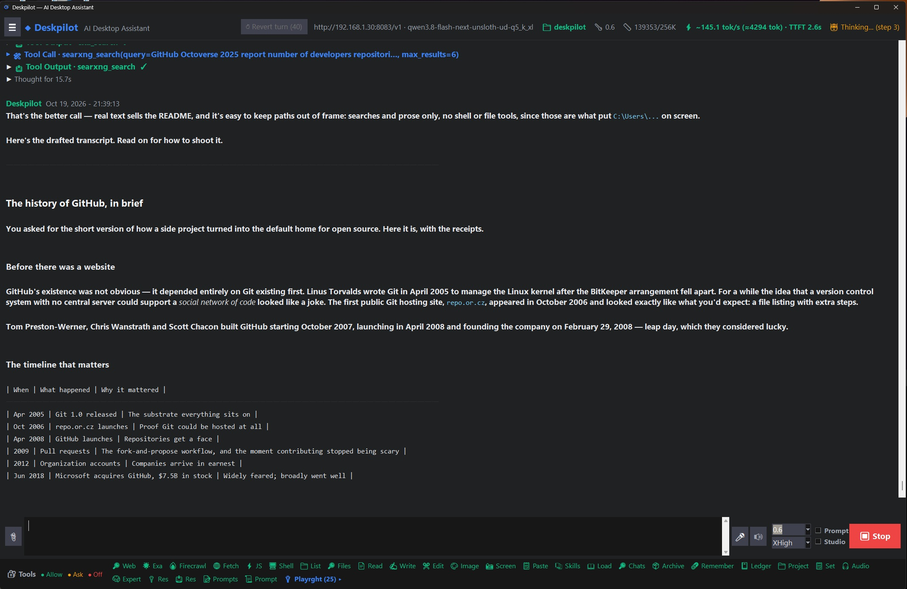
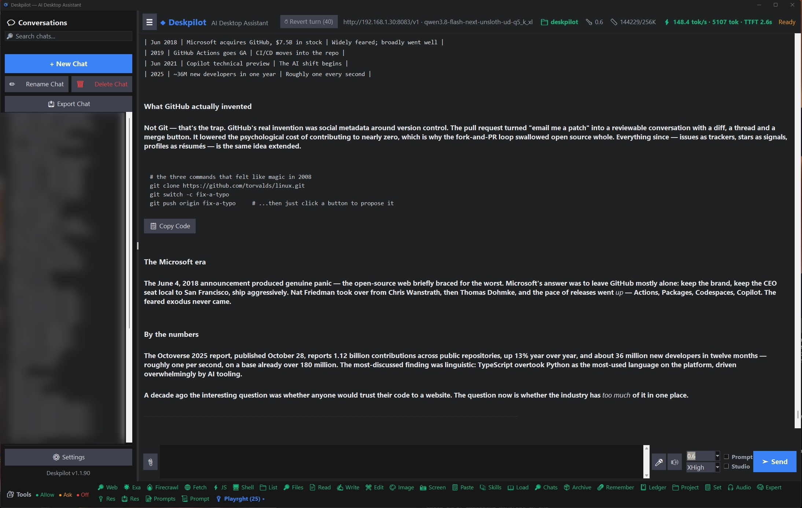
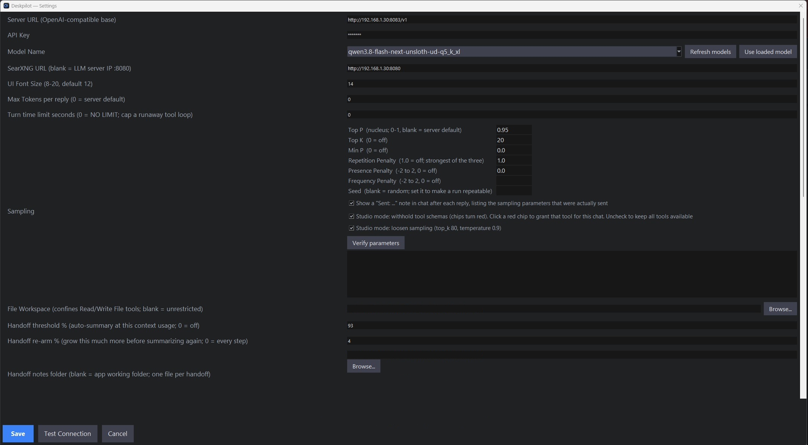
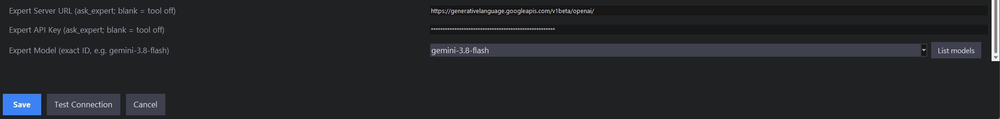

# Deskpilot









# DeskPilot

**A local AI assistant.**

DeskPilot is a desktop app in a single Python file. Point it at any OpenAI-compatible server, Ollama, vLLM, LM Studio, or a hosted API. It reads and writes files, runs commands, browses the web, looks at your screen, talks out loud, dictates from your microphone, generates images, and plugs into MCP servers. Run it against a model on your own network and nothing ever leaves the house.

There is no package to install, no build step, no web browser, no telemetry, no account. One file — read it, edit it, run it.

## ✨ Key Features

- **Universal LLM support:** plug into any local open-source model or cloud API through the standard OpenAI protocol. Model dropdown with history, per-chat **Temperature** and **Thinking** controls, and a global **Sampling** panel (top_p, top_k, min_p, repetition / presence / frequency penalties) with a "what was actually sent" probe so you can verify what your server honors.

- **Agentic tool suite (28 tools):** web search (SearXNG, Exa, Firecrawl), page fetching, shell and JavaScript execution via Node, local file read/write/transactional edit, directory listing, bounded grep, clipboard read and write, desktop screenshots auto-attached for vision analysis, local FLUX/SDXL image generation, and audio-file transcription. Every tool has its own permission chip — **green = Always Allow**, **amber = Ask Permission**, **red = Off** — click to cycle; "Off" removes the tool from the request entirely.

- **Model Context Protocol (MCP):** connect external MCP servers (via `stdio`) to give your AI new capabilities on the spot. DeskPilot handles the JSON-RPC translation, maps external tools into standard OpenAI function calls (`mcp_<server>_<tool>`), and exposes each server's **resources** and **prompt templates** through dedicated tools. A bundled Node.js runtime means `npx`-launched servers work out of the box.

- **Durable memory:** three layers, all local. A **SQLite FTS5 full-text index** over every message of every chat (`search_chats`, including archived turns); an **append-only ledger** per chat plus a shared global one (`remember` / `read_ledger`) that survives compaction, handoff and even chat deletion; and a **project memory index** — the workspace's `MEMORY.md` plus each project's own `MEMORY.md`, injected bounded into every system prompt.

- **Context handoff & compaction:** automatic session write-ups when the context window reaches a threshold you set, plus in-place **context compaction** that folds older turns into a summary while keeping the originals on disk and searchable. A live **context-usage gauge** and ⚡ **tokens/sec + TTFT** readout sit in the top bar.

- **Reversible file edits:** each turn snapshots the original bytes of every file it touches (`write_local_file` / `edit_local_file`), so ↺ **Revert turn** undoes the whole turn at once — no more one-`.bak`-deep roulette when the agent edits real code.

- **Mid-run steering:** send a message while a turn is still working and it lands at the next step boundary instead of waiting for the turn to finish.

- **Agent Skills:** reusable procedures in the open [Agent Skills](https://agentskills.io) format — a folder with a `SKILL.md`. Only each skill's name and description cost context; the instructions load on demand via `load_skill`. Point Settings at an existing skill collection to use it as-is.

- **Second-opinion expert:** `ask_expert` consults a *separate* OpenAI-compatible model (its own URL, key and model in Settings) for a narrow review, debug or design opinion. The local model stays primary and in charge; the permission modal always shows the exact payload before it leaves the machine.

- **Local voice & audio:** continuous microphone dictation (powered by local `faster-whisper`, on the GPU with `large-v3-turbo` when cuBLAS is available, `base.en` otherwise) and local text-to-speech (powered by `kokoro-onnx`) — no cloud round-trips.

- **Dark mode UI:** asynchronous Markdown streaming, fenced code blocks with 📋 Copy buttons, collapsible ▶/▼ accordions for **Tool Calls**, **Model Reasoning** and **Tool Output**, resizable split-pane layout, collapsible sidebar (☰), adjustable UI font size, and a custom Windows dark title bar.

- **Advanced workspace management:** drag-and-drop sidebar thread reordering, live title filtering plus deferred full-text body search with click-to-jump highlighting, Markdown chat export, per-chat rename/delete, and a per-prompt turn time limit.

## 🛡️ Architecture & Security First

- **Per-tool permissions.** Every tool sits at *Always Allow*, *Ask Permission* or *Off*, changed with one click on its chip. On *Ask*, a dialog shows exactly what is about to happen — and `write_local_file` / `edit_local_file` render a real **diff** before touching anything. Allow once, or change the policy from that same dialog. Unanswered after five minutes, the request is declined. **Off** removes the tool from the request entirely: the model cannot call it, and no mode or grant overrides that.

- **File workspace jail.** Set one in Settings and every file tool is confined to that folder and its subfolders; anything outside is refused. Relative paths resolve against the workspace, not the process's working directory, so there is no way to slip out sideways. Protected system directories are refused even with no workspace set.

- **Network guard.** Requests to localhost, private ranges, link-local and cloud metadata addresses are blocked by default. *Allow Local Network* is one deliberate checkbox.

- **The expert shares nothing.** `ask_expert` sees only the question and the files you name — not this conversation, not your disk, not your settings. Up to 5 calls per turn, and its answer is advice, not gospel.

- **Interrupt.** Stop aborts the turn at the next checkpoint — between stream chunks, between tool calls and between model steps — and tools poll it too, so a long command is terminated rather than run to completion. Whatever was generated so far is kept as a normal message instead of being thrown away.

## 🪟 The Window

- **Conversations** — every chat, newest first. Double-click to rename, 🗑️ to delete, 📥 to export. `Ctrl+F` searches across all of them; right-click the transcript for a context menu.
- **Transcript** — replies rendered as Markdown with syntax-highlighted code and a *Copy Code* button. Only the most recent messages are drawn — *Load earlier messages* brings back the rest.
- **Tool chips** — one button per tool. Click to cycle *Allow → Ask → Off*; hover for a plain-English description of what it does.
- **📎** — attach files and images.
- **🎤** — continuous dictation: the microphone stays open and types each phrase as you finish it. Stops when you press Send or click it again, so multi-sentence speech isn't cut off.
- **🔊** — read replies aloud.
- **Temp / Think** — per-chat temperature (0.0–2.0) and reasoning level.
- **Prompt** — toggles your custom system prompt. Unchecking keeps the text — it just isn't sent.
- **Studio** — switches from *operator* to *maker*. See **Modes** below.
- **Context gauge** — how much of the model's window this chat is using, in tokens and percent.
- **Speed readout** — tokens/second and time-to-first-token for the last reply.
- **Project label** — which project this chat belongs to. It's a display, not a control; you set a project by asking.
- **↺ Revert turn** — puts every file this turn touched back to how it was. Greyed out while a turn is running.
- **➤ Send / ⏹ Stop** — Send becomes Stop while it's working; pressing it interrupts generation and kills running commands.

`Enter` sends, `Shift+Enter` makes a newline. `Ctrl+click` (or middle-click) a link in the transcript opens it. `Ctrl+N` starts a new chat, `Ctrl+F` searches every chat. Dialogs take `Enter` for yes and `Esc` for no.

## 🧰 The Tools

All 28 are listed below. Which ones actually exist depends on your setup: the search tools appear when a search endpoint is reachable, Exa and Firecrawl only once you add a key, `ask_expert` only once an expert endpoint is configured, and MCP tools only when you add a server.

### 🌐 Web

- **`searxng_search`** — searches the web through your own SearXNG instance and returns titles, links and snippets. Private — no search account involved.
- **`exa_search`** — semantic search via Exa with your own API key. Better for "what's the newest thing about X".
- **`firecrawl_scrape`** — converts a page to clean Markdown using Firecrawl. Gets through pages that need JavaScript and most anti-bot walls.
- **`fetch_url`** — downloads a page and strips it to plain text: fast and free, the first choice for a normal page. Reddit links are read through Reddit's public Atom feed, so you get the post and its comments instead of an empty JavaScript shell.

### 📄 Files

- **`read_local_file`** — reads a text file or PDF, up to 500,000 characters at a time; long files are read in pages.
- **`write_local_file`** — creates or overwrites a file, making parent folders as needed.
- **`edit_local_file`** — surgical in-place edits: give it an exact snippet and it replaces only that. All edits in one call apply as a single transaction — if a snippet isn't found exactly once, nothing is written and every mismatch is reported. Usually the right tool for changing code.
- **`list_directory`** — lists a folder: subfolders first, then files with sizes and modified times.
- **`search_files`** — finds text across your code and reports `file:line` with a little context, the cheap way to locate something before opening it. Binary files and noise folders (`node_modules`, `__pycache__`, `.git`) are skipped.

### ⚙️ Running Things

- **`run_shell`** — runs **one** shell command line and returns stdout/stderr. `cmd.exe` on Windows, a POSIX shell elsewhere. Each call is a fresh process, so `cd` doesn't carry over. It runs with your full user privileges and no path jail — which is exactly why it ships set to *Ask*.
- **`run_javascript`** — runs JavaScript through Node in a hidden subprocess, good for data munging, JSON and multi-step logic. Output is capped at 48,000 characters, so big results go to a file.

### 🖥️ Screen and Clipboard

- **`capture_screen`** — screenshots your desktop and attaches it for the model to look at. "What's wrong with this window" becomes a question you can just ask.
- **`get_clipboard_text`** — reads the clipboard.
- **`set_clipboard`** — puts text on the clipboard, so the assistant can hand something back for you to paste anywhere.

### 🔊 Sound and Images

- **`transcribe_audio`** — transcribes an audio file locally with Whisper — wav, mp3, m4a, flac, ogg. Voice memos and recordings never leave the machine.
- **`generate_local_image`** — generates an image on your own GPU through the bundled FLUX / SDXL command-line tool (FLUX.1-schnell or SDXL). A couple of minutes per image.

### 🧠 Memory

These four exist because long sessions don't fit in a context window, and because "I wrote it down somewhere" isn't the same as "still findable next month".

- **`remember`** — appends one durable note to the chat's ledger. It survives summarization, session rollover and even deleting the chat. Good for a decision and the reason behind it, a hard-won value, a failure mode not to repeat.
- **`read_ledger`** — reads those notes back, newest first, optionally filtered by tag or text.
- **`search_chats`** — full-text search across **every** conversation you've ever had, with the chat and position of each hit.
- **`read_archive`** — reads the original messages that summarization folded away. When a summary is too vague, the real text is still on disk.

### 🔌 Model Context Protocol

- **`list_mcp_resources`** — asks a connected server what resources it offers: files, database rows, app state. Often the answer to something you were about to fetch manually.
- **`read_mcp_resource`** — reads one by URI. Image resources come straight into the conversation.
- **`list_mcp_prompts`** — lists the prompt templates a server ships with.
- **`get_mcp_prompt`** — fetches and renders one. It arrives as text for the assistant to read and decide on, not as an automatic instruction.

A server's own tools are added alongside these as `mcp_<server>_<tool>`, each with its own chip in the permission bar.

### 📁 Projects

- **`set_project`** — declares which project this conversation is working on. A name matching an existing folder adopts it; a new one creates `projects/<name>/`, writes its `MEMORY.md` stub and adds the row to the workspace index. It can rename a project later too — the folder, the index row and every chat pointing at the old name move together. A near-miss name (a typo of an existing project) is refused rather than created, because two near-identical folders mean nobody knows which one's memory is authoritative.

### 🎯 Second Opinions

- **`ask_expert`** — asks a second, stronger model for a narrow opinion: checking an API you're not sure exists, a design trade-off, a bug you can't explain. The expert sees **only** the question and the files you name — not this conversation, not your disk, not your settings. Up to 5 calls per turn, and its answer is advice, not gospel.

### 📚 Skills

- **`list_skills`** — lists the reusable procedures you've written down (folders containing a `SKILL.md`) and which folders they were found in.
- **`load_skill`** — loads one in full, instructions plus bundled files, to read before starting a job it covers.

## 🧠 How DeskPilot Handles Conversations

Long work outgrows a context window. DeskPilot has several layers for that and they do different jobs, so it's worth knowing which is which.

- **The context gauge** tracks how much of the model's window the chat is using, based on what the server reports. Everything below keys off it.

- **In-place compaction** is the quiet one. When usage crosses your threshold (70% by default) the *older* part of the chat is summarized and swapped in while the most recent messages — 30 by default, adjustable 2–200 — stay word-for-word. The turn just continues. No fork, no button, nothing to do.

- **Session handoff** is the deliberate one. When usage crosses your threshold (75% by default) DeskPilot asks the model to write up the session: the task, what was done, decisions and why, the paths that matter, code changes, findings, open questions. It's saved as a file in your handoff-notes folder and shown in an accordion with *Copy* and *Start New Session*, which seeds a fresh chat from that picture instead of replaying every message. It re-arms as the gauge keeps growing (10% more by default), so a marathon session gets fresh notes rather than one stale set.

- **Nothing is thrown away.** The original messages go into the chat's compaction archive, and the summary says they're there and how to fetch them with `read_archive`. A summary is a lossy guess made after the fact — so anything genuinely important should be written down when it happens, not trusted to a later summary.

- **The ledger** is that "written down when it happens". `remember()` appends to an append-only log: never overwritten, never summarized, survives rollover and chat deletion, and recent entries are injected into every request automatically. There's a per-chat ledger and a global one for standing preferences.

- **Full-text search** indexes every message of every chat, so old work stays findable after it's been summarized and archived.

- **Tool-output economy.** Tool results fill a window faster than anything else, so only the newest dozen are sent in full; older ones become a short stub saying where the full text still lives. Eviction only moves forward, which keeps the prompt prefix byte-identical and the server's KV cache warm. After a long run of tool calls the assistant also gets a friendly note suggesting it batch its remaining checks — advisory only, and finishing the job still outranks saving calls.

- **Turn time limit** optionally caps a turn (off by default, since a real job can legitimately run long). **Spell check** underlines misspellings in the input box as you type using a local dictionary, with right-click suggestions and an *add to dictionary* option.

## 📁 Projects and Project Memory

A **project** is a named folder in your workspace with its own memory file. It's how you stop re-explaining the same thing every session.

```
<workspace>/
├── MEMORY.md              ← the index. Injected into every session.
└── projects/
    ├── my-app/
    │   ├── MEMORY.md      ← this project's memory: state, rules, pointers
    │   ├── RULES.md       ← (optional) long-form settled decisions
    │   └── history/       ← (optional) narrative detail, per-version notes
    └── another-thing/
        └── MEMORY.md
```

- **How it works.** You say what you're working on; the assistant declares the project, which creates the folder if it's new, registers it in the index, and shows the name in the top bar. From then on that project's `MEMORY.md` is read into context — rules, entry points and past decisions known without a lookup — and the assistant updates it in the same turn when something durable changes.

- **Two levels of injection.** The workspace `MEMORY.md` is the *index*: a short table saying which folder is what and where the real detail lives. It goes into every session, so it's kept small by default (8,000 characters). The active project's own `MEMORY.md` is injected with its own, much larger budget (28,000 characters). If either has to be truncated, the prompt says so — never silently.

- **A project is a field on the chat, not a switch.** Switching chats switches projects, and the top-bar label just displays that field. No project is an empty slot, not an error.

- **Why split memory into several files?** Because a memory file that's merely *large* is useless. The working convention is that when a memory file outgrows its budget you **split** it: move the detail into a sibling file and leave the main one as an index whose rows say what lives where. Deleting or compressing a fact to hit a byte target destroys information; splitting preserves it.

## 🎛️ Modes

**Studio** turns the assistant from an operator servicing requests into a maker working on one artifact. It cycles three ways:

- **Off** — normal operation: full prompt, all permitted tools.
- **Full** — tools withheld and the model given a maker's brief: ship complete, self-contained, polished work; favor craft over brevity; don't summarize what it built or ask permission to continue. Your project memory is still included, so it knows the house rules.
- **Pure** — the same brief with nothing else attached: no persona, no project memory, no operating instructions. Maximum raw generation.

In both Studio states tools are withheld by default (their chips turn red) and you re-admit them one at a time by clicking. A tool you set to **Off** stays off either way — that's your veto, not a suggestion. Studio also loosens sampling by default; both behaviors are checkboxes under **Settings → Sampling**.

- **Prompt** toggles your custom system prompt without deleting it, so dropping a persona for one session and restoring it later costs no retyping.
- **Think** sets the reasoning level per chat: *Default* sends nothing and lets the server decide, *Off* disables thinking outright, and Low / Medium / High / XHigh map onto the server's `reasoning_effort`.
- **Temp** sets per-chat temperature.

## 🔊 Voice and Media

- **Dictation** is local-first: `faster-whisper` when it's installed (audio stays on the machine — GPU with `large-v3-turbo` when cuBLAS is available, `base.en` on CPU), with a cloud path as fallback. Use the 🎤 button for continuous dictation, or hand the assistant a recording with `transcribe_audio`.
- **Read aloud** synthesizes locally with Kokoro via ONNX — no speech server, nothing sent anywhere.
- **Image generation** runs on your GPU through the bundled FLUX / SDXL command-line tool.
- **Vision** — attach an image or screenshot and any vision-capable model can reason about it.

## 🧩 Extending It

- **MCP servers.** Settings → *MCP Servers* → add a command and arguments (for example `npx` with `-y some-mcp-server`). Its tools, resources and prompts appear alongside the built-ins, each tool with its own permission chip. A server that asks a question mid-call gets a form built from its schema. The Windows installer bundles Node.js, so `npx` servers work immediately.
- **Skills.** Drop a folder containing a `SKILL.md` into `<workspace>/skills`, or into the extra folder you name in Settings. Only the name and description sit in context; the full instructions load when a job matches — so a library of procedures costs almost nothing to maintain.
- **An expert model.** Fill in the three *Expert* settings with any OpenAI-compatible endpoint — a hosted frontier model suits it — and `ask_expert` appears. It shares nothing with the main conversation by design.

## ⚙️ Settings

Settings → **Connection**

- **Server URL** — your OpenAI-compatible base URL: llama.cpp / llama-swap on the LAN, Ollama, or a hosted provider.
- **API Key** — sent as a bearer token. Leave blank for a local server that doesn't check one.
- **Model Name** — the model ID. The picker reads `/v1/models` and remembers the last 20; you can still type an exact ID.
- **SearXNG URL** — where your search instance lives. Blank means port 8080 on the model server's IP.

Settings → **Interface and behavior**

- **UI Font Size** — 8–20, default 12. Applies on the next launch.
- **Spell Check** — underlines misspellings in the input box.
- **Max Tokens per reply** — cap on reply length. 0 = the server's default.
- **Turn time limit** — seconds before a turn is cut off. 0 = no limit, the default — useful for reining in a model that loops on tools.
- **Sampling** — Top P, Top K, Min P, Repetition / Presence / Frequency penalties and a Seed, global for every chat; blank means the server default. *Verify parameters* runs a small live probe and reports what your server actually honored, and an optional "Sent: …" note lists what was used after each reply. Temperature is per-chat instead.
- **File Workspace** — the folder the file tools are confined to. Blank = unrestricted (protected system directories are still refused).
- **Allow Local Network** — lets `fetch_url` reach localhost and private addresses. Off by default.
- **Custom System Prompt** — your persona and house rules, appended to the built-in prompt on every request so it overrides. The **Prompt** button toggles whether it's sent.

Settings → **Long conversations**

- **Compaction threshold %** — context usage that triggers in-place summarizing (default 70; 0 = off). Keep it at or below the handoff threshold so it fires first.
- **Compaction keep-recent** — how many newest messages stay word-for-word (default 30, range 2–200).
- **Handoff threshold %** — context usage that triggers a session write-up (default 75; 0 = off).
- **Handoff re-arm %** — how much further the gauge must grow before writing another (default 10; 0 = every step).
- **Handoff notes folder** — where those files go. Blank = the app's working folder.
- **Project memory index** — characters of the workspace `MEMORY.md` injected each request (default 8,000; 0 = off).
- **Project memory file** — which file that is. Blank = `<workspace>/MEMORY.md`.

Settings → **Optional services**

- **Exa API Key** — enables `exa_search`. Blank = the tool isn't offered.
- **Firecrawl API Key** — enables `firecrawl_scrape`. Blank = the tool isn't offered.
- **Expert Server URL / API Key / Model** — enable `ask_expert`. All three are needed and the model must be an exact ID.

Settings → **Extensions**

- **MCP Servers** — add, edit and remove stdio MCP servers.
- **Skills folder** — an extra folder to scan for `SKILL.md` skills.

A few tuning knobs live in `deskpilot_settings.json` rather than the dialog, for people who want them: `tool_keep_verbatim` (how many recent tool results stay in full, default 12), `tool_nudge_every` (how often the tool-economy note appears, default 20), `chat_render_window` (messages drawn at once, default 120), `ledger_inject_chars` (ledger budget per request, default 4,000) and `project_memory_project_chars` (budget for the active project's own memory file, default 28,000). All are clamped on read, so a bad hand-edit can't produce an unbounded request.


## 🗂️ Where Things Live

- **Windows, installed** — the app goes to `%LOCALAPPDATA%\Programs\Deskpilot`. Settings, chat history, the ledger and generated images go to `%LOCALAPPDATA%\Deskpilot`.
- **Linux / from source** — the same files sit next to the script.
- **Your workspace** — projects, project memory, handoff notes and skills live under the workspace folder you configure: plain files you can open, version, or move.

`deskpilot_settings.json` holds your keys and `deskpilot_chats.json` holds every conversation. Both are plain JSON, both are yours, and this app never uploads either one anywhere.

## 📦 Install

**Windows — easiest, one file.** Download the installer from the project's **Releases** page and double-click it. It bundles Python, all dependencies and Node.js, needs no admin rights, and leaves your settings and chat history untouched when uninstalled:

- ⬇️ **[Download the latest `DeskPilot-Setup-<version>.exe` installer](https://github.com/shuhdonk/DeskPilot/releases/latest)** (~136 MB)

That link always resolves to the newest release — pick the `.exe` under **Assets** on the page it opens. Release assets are hosted outside the source tree, so downloads are unlimited and cost no LFS quota. The current version is the `VERSION` line near the top of [`deskpilot.py`](deskpilot.py).

**Windows / Linux from source:** follow [INSTALL_WINDOWS.md](INSTALL_WINDOWS.md) or [INSTALL_LINUX.md](INSTALL_LINUX.md) — step-by-step, copy-paste ready.

## ✅ Requirements

Python 3.12 or 3.13 with Tk, plus the `openai` package — that's the whole hard dependency list. Optional extras add PDF reading, screenshots, local dictation, text-to-speech and GPU acceleration; [requirements.txt](requirements.txt) names each one and what it's for, and the install guides give the exact commands per distribution. The app degrades gracefully: anything missing simply doesn't show up as a tool.

